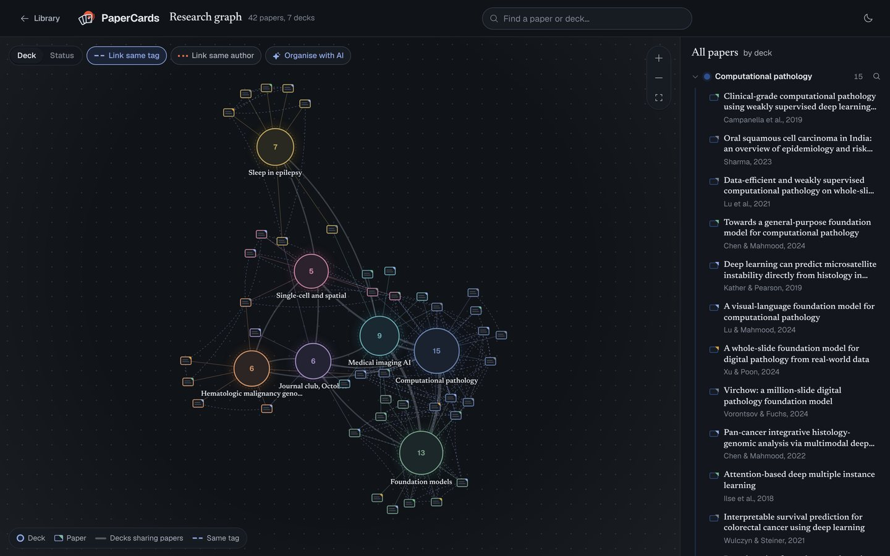
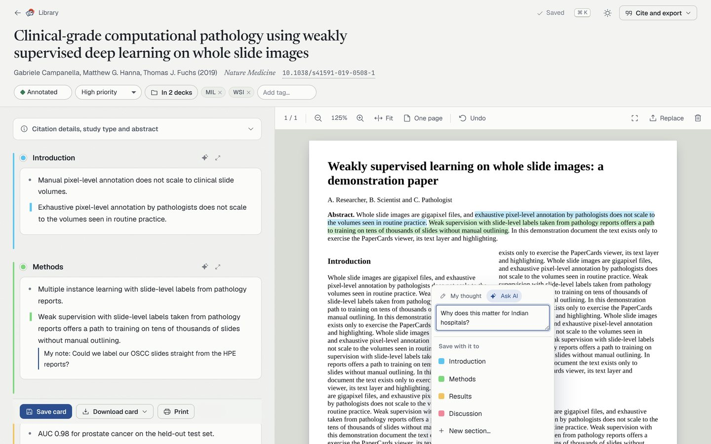
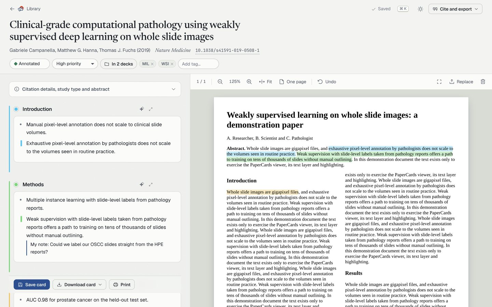
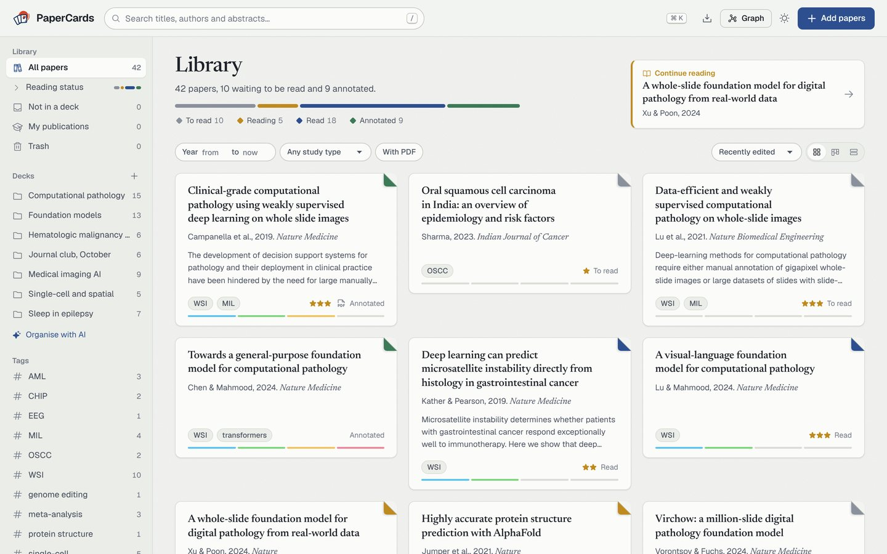
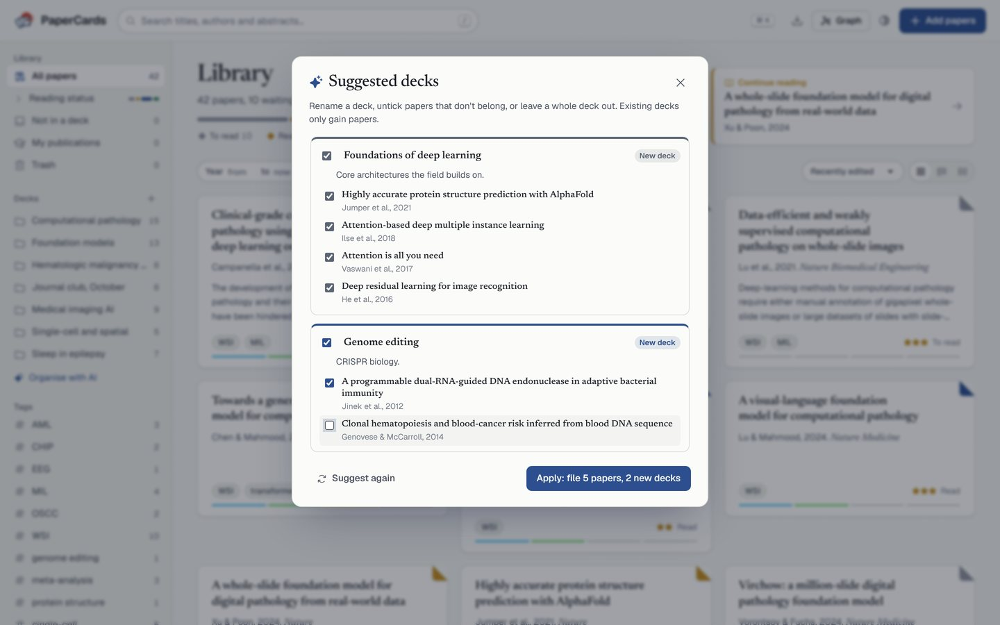

<p align="center">
  
</p>

<h1 align="center">PaperCards</h1>

<p align="center">
  <strong>Every paper you read, and what you made of it.</strong><br />
  A reference and PDF manager for researchers, PhD and medical students. Highlight a PDF, and the passage lands in your notes under the right section.
</p>

<p align="center">
  <a href="https://papercards-pi.vercel.app"><b>Try the live demo</b></a> ·
  <a href="https://papercards-pi.vercel.app/feedback?product=papercards">Share feedback</a>
</p>



## What it does

| | |
|---|---|
|  | **Highlight → notes.** Select any passage in a PDF and file it to Introduction, Methods, Results, Discussion or a section you name. Add your own thought, or ask AI about the passage. Erase or undo, and the note and highlight stay in sync. |
|  | **Every paper becomes a card.** Notes grouped by section as you read. Save, print, or download the card as PDF or Word. |
|  | **Your library at a glance.** Decks, tags, reading status, priority stars, a reading shelf, Trash with 30-day restore, and My publications from ORCID and OpenAlex. Export BibTeX, RIS or Excel. |
|  | **AI that tidies up.** One tap and Gemini suggests decks from titles and abstracts. Nothing changes until you review and apply, and it can be undone. |

Also: a research graph (decks, papers, shared-paper bridges, tag and author threads), DOI and PDF import with Crossref lookup, light and dark themes, a command palette (⌘K), guest demo libraries that can be kept as an account, and an optional "use my own Gemini key" setting.

## Built with

Next.js 16 (App Router, React 19) · Supabase (Postgres with row-level security, Auth, Storage) · pdf.js · d3-force · Motion · Google Gemini (server-side) · Vercel

## Run it locally

```bash
npm install
cp .env.local.example .env.local   # PaperCards Supabase URL + anon key
npm run dev                         # http://localhost:3002
```

Apply the SQL files in `supabase/migrations/` to your Supabase project in order (SQL editor or `npx supabase db push`). For AI notes and decks, set `GEMINI_API_KEY` (server only). The full runbook, rules and architecture are in [CLAUDE.md](CLAUDE.md).

| Command | What it does |
|---|---|
| `npm run dev` | Dev server on port 3002 |
| `npm run build` / `npm start` | Production build / serve |
| `npm test` | Unit tests (DOI parsing, Crossref, BibTeX/RIS, auth and feedback checks) |
| `npm run typecheck` / `npm run lint` | TypeScript and ESLint |

`tests/e2e/mock-supabase.mjs` is an in-memory stand-in for Supabase, Gemini, ORCID and OpenAlex, used for local UI testing.

## Privacy

Each library is private to its account and protected by row-level security. PDFs live in a private storage bucket. AI calls run on the server, and keys never reach the browser.

## Author

Built by **Amith Paruchuri**, final-year MBBS student. Feedback is very welcome: [papercards-pi.vercel.app/feedback](https://papercards-pi.vercel.app/feedback).
